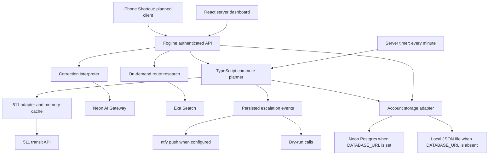

# Fogline APIs and tools

Updated against the repository on **October 4, 2026**, including the server-hardening pass and Neon AI Gateway migration. The user-supplied live audit reports a successful Neon account read (revision 16); the gateway migration verified live inference with synthetic inputs. This document distinguishes implemented behavior, credential presence, previously recorded verification, and proposed work. Credential values are intentionally omitted. A configured key does not establish successful authentication, available credits, or a healthy deployed service.

## How the services fit together

Fogline has two separate experiences: a browser-local demo, and a personal server account. The demo saves to `localStorage` under `fogline-v1`; its taps do not create server rides. The server account uses the real clock and persists through the storage adapter.



Neon AI Gateway serves the AI requests above. Postgres stores account data, while the planner and transit API calculate commute times. Fogline decides what to send to a model and validates any returned action before applying it.

## Integration inventory

Sponsor labels follow [the hackathon sponsor table](hackathon-info.md#sponsor-tools), not independently verified sponsorship or credit balances.

| Service or tool | Sponsor? | Role in this app | Current evidence |
|---|---|---|---|
| Neon Postgres | Yes | Persistent personal account, rides, preferences, briefing and events | Implemented; `DATABASE_URL` is set and points to a Neon host. The supplied live audit reports an account read at revision 16; not repeated in this pass. |
| Neon AI Gateway | Yes | Ask Fogline and preparation corrections | Configured; live tool calls verified. |
| Mastra Gateway | Yes | Previous inference provider | Replaced by Neon AI Gateway. |
| Mastra framework | Yes | Potential agent orchestration framework | `@mastra/core` is not installed. Current orchestration is plain TypeScript. |
| Exa | Yes | Finds recent public route reports | Search implemented; key set. No live search tested in this audit. |
| 511 transit API | No | Official arrivals, scheduled times and service alerts | Implemented; key set. An earlier entry in this document recorded a successful live response on Oct 4; not repeated in this audit. |
| Assistant UI | Yes | Potential chat/interface components | Not installed. Current interface uses custom React components. |
| CodeRabbit | Yes | Potential repository/PR review | Repository integration and account access not verified. No app runtime role. |
| Fly.io / Sprites | Yes | Proposed hosting for a reachable server and scheduler | No deployment configuration found; local token empty or absent. Remote hosting was not inspected. |
| AgentMail | Yes | Proposed evening summaries and reply-to-correct | No runtime integration; key empty or absent. |
| ntfy | No | Optional push notification delivery | HTTP publisher and test endpoint implemented. Requires a valid topic; phone receipt remains unverified. |
| Twilio | No | Proposed escalation phone calls and acknowledgement | Credentials/numbers empty or absent; no call or webhook integration. |
| Leaflet / OpenStreetMap | No | Stop selection and latest vehicle positions | Local Leaflet assets, OpenStreetMap tiles and guided line/stop selection are wired. |
| iPhone Shortcut | No | Alarm-stopped trigger to fetch and speak a briefing | Server endpoint exists; phone automation/reachability not verified. |
| Kernel | Yes | Browser automation in original tool inventory | Skipped; no app integration; key empty or absent. |
| Executor | Yes | Tools/MCP gateway in original tool inventory | Skipped; no app integration; key empty or absent. |

## Neon Postgres: durable account storage

**Implementation:** [server/store.ts](server/store.ts), [server/agent.ts](server/agent.ts), [account types](src/agent-types.ts).

`accountStore()` selects its backend at service creation. A nonempty `DATABASE_URL` uses `@neondatabase/serverless`; without it the app uses `data/account.json`. Once Neon is selected, database errors are reported rather than silently falling back to the file.

The current schema is one table, with one account row named `personal`:

| Column | Type | Meaning |
|---|---|---|
| `id` | `text PRIMARY KEY` | Fixed account identifier, currently `personal` |
| `revision` | `integer NOT NULL` | Used to reject competing updates |
| `state` | `jsonb NOT NULL` | Complete account state as one JSON document |
| `updated_at` | `timestamptz NOT NULL` | Creation/update timestamp |

The state contains the commute profile, agent settings, current briefing, rides/check-ins, pending tomorrow preparation override, learning marker, and events. The app retains up to 365 ride records and 500 events. It does not have separate relational tables for users, rides, transit caches, or model conversations.

On the first storage operation in a process, the adapter creates `fogline_accounts` if needed, checks for the personal account, and copies an existing local account only if the cloud account is absent. The local file is left intact. Reads fetch the account JSON. Saves insert or replace the entire document, checking the previous revision on an existing row. A revision conflict throws an error; the database conflict currently surfaces as a generic HTTP 500, whereas the explicit settings revision check returns 409.

The agent serializes local operations in an in-process queue and re-reads state before applying changes. Revision checks help reject cross-process overwrites, but do not coordinate multiple schedulers: use one scheduler process per account. This is a personal account design, not multi-user authentication or per-user tenancy.

**Traffic detail:** the timer runs every 60 seconds when an account token is present. `tick()` enters a write transaction before checking whether automated planning is enabled or within its weekday window, so it currently reads and saves state even when planning is skipped. Dashboard refresh reads every 30 seconds while connected and on window focus. Both patterns can create database traffic independently of AI usage. The 511 and Exa caches are process memory, not Postgres caches.

The database URL is set locally; older statements that it was empty are obsolete. The supplied October 4 live audit reports a successful account read at revision 16. This hardening pass did not connect to the database or verify migration/restart behavior. Storage status in the UI only reflects configuration.

## Neon AI Gateway: the current AI request path

**Implementation:** [server/integrations.ts](server/integrations.ts), [correction handler](server/agent.ts), [server UI](src/ServerMorning.tsx).

Submitting “Adjust tomorrow” sends `POST /api/agent/correct` with `{ "text": "I need 45 minutes to get ready tomorrow" }`. The server accepts a nonblank string of up to 1,000 characters and sends one request to:

```text
POST ${NEON_AI_GATEWAY_BASE_URL}/v1/chat/completions
Authorization: Bearer <NEON_AI_GATEWAY_TOKEN>
```

The model defaults to `gemini-3-flash`; `NEON_AI_MODEL` can override it. The current local override is empty/absent, so the default applies. The request sets temperature to zero, requires a tool choice, and includes a system instruction, the submitted text, and three function definitions. It does not send the account document, ride history, transit feed or current plan. Anything the user types into the field is included in the submitted text.

| Model-returned tool | Meaning | What Fogline actually does |
|---|---|---|
| `set_tomorrow_ready_minutes` | An explicitly stated total preparation time | Validates an integer from 5 to 180, saves a dated `readyOverride`, logs a decision and recomputes the briefing. Today's preparation preference stays unchanged. |
| `read_current_plan` | A request to read/explain the plan | Recomputes and returns the deterministic briefing; the model does not generate an explanation from the plan. |
| `ask_for_clarification` | Unsupported or ambiguous request | Returns HTTP 422 with guidance to give an explicit total or use Setup. |

These “tools” are structured model outputs, not independent APIs the model executes. `decodeCorrection()` requires exactly one tool call and parses its arguments. Unknown actions, multiple/missing calls, malformed arguments and invalid durations become clarification. The prompt instructs the model not to interpret “five more minutes” as a total; the decoder validates the returned number but does not independently prove the user's semantic intent.

The model call happens outside the storage queue, then the handler re-reads current account state before applying the result. The request has a 30-second timeout, no explicit automatic retry and no streaming. Provider HTTP failures and connection failures become sanitized HTTP 502 errors; raw provider bodies and credentials are not returned to the browser. Successful HTTP/JSON responses update the in-memory `lastSuccess` status before semantic tool validation, so that timestamp alone does not prove a correction was applied.

This is a direct HTTP call using `fetch`, not a Mastra framework agent. There is no installed Mastra workflow, memory or tracing subsystem. The background planner does not call an LLM.

## Neon gateway configuration and verification

Set `NEON_AI_GATEWAY_TOKEN` and `NEON_AI_GATEWAY_BASE_URL` on the server. The URL must be a bare HTTPS Neon host; Fogline appends `/v1/chat/completions`. `NEON_AI_MODEL` defaults to `gemini-3-flash`, verified in the Fogline branch catalog. Missing or invalid configuration fails explicitly; there is no Mastra fallback. Credentials stay server-side.

On October 4, the existing Fogline production branch in `aws-us-east-2` reported its gateway enabled. Its existing credential has `ai_gateway:invoke` scope. A live correction returned the requested 45-minute value and a live chat request returned `read_morning_state`. These smoke checks used synthetic inputs and did not change the account. They verify inference access, not the remaining prepaid balance.

Ask Fogline uses this same gateway adapter with automatic tool choice, then executes validated tools in `server/morning.ts`. The correction endpoint requires a tool choice. Prompts, tool limits, deterministic calculations and account storage remain in Fogline. Exa remains a separate research API.

See Neon's [Chat Completions reference](https://neon.com/docs/ai-gateway/chat-completions) and [quickstart](https://neon.com/docs/ai-gateway/get-started).

## Exa: same-day route research

**Implementation:** [server/commute-research.ts](server/commute-research.ts) and [server/exa-assessment.ts](server/exa-assessment.ts).

Saved commute checks, temporary previews, tracked rides, and `POST /api/agent/research` use the same research gate. A valid leave-to-estimated-arrival window is required. Research opens on the local day of departure, two hours before leaving, and closes at estimated arrival. Skipped and completed account rides are excluded. Outside this window the response is `deferred`, with no sources or completed search timestamp. Manual refresh cannot bypass the gate.

Eligible requests call `POST https://api.exa.ai/answer` with the server’s `EXA_API_KEY`, a structured output schema, and citation text. Queries include the public route, direction, boarding and alighting stops, service day, and travel window. They exclude account keys, personal destination labels, and ride history. Official notices are preferred; there is no domain allowlist.

Only cited findings with matching quoted evidence, explicit impact times, and overlap with the trip are displayed. Unrelated, expired, undated, and non-overlapping sources are omitted. Publication date is not the impact date. Normal-service findings require an official SFMTA or 511 source covering the entire trip. No qualifying results means unconfirmed, never an all-clear. Research does not change transit predictions.

Successful reports are cached for 30 minutes, failures for 10 minutes, keyed by route, stops, service day, and travel window. Concurrent requests coalesce. Explicit refresh bypasses completed cache entries. Provider requests time out after 20 seconds; failures preserve the transit plan and return an unavailable report.

## 511: official transit inputs

**Implementation:** [server/transit.mjs](server/transit.mjs); numeric planning in [server/agent.ts](server/agent.ts).

The server uses `SF511_API_KEY` to call `https://api.511.org/transit`. The credential is added to the upstream query string, never sent to the browser as a configuration value.

| Upstream path | Request context | Data used |
|---|---|---|
| `/servicealerts` | Agency `SF`, JSON format | Alert headers/descriptions and affected routes |
| `/StopMonitoring` | Agency `SF`, configured numeric stop code | Line, destination, aimed/expected time, stop, vehicle and status |
| `/stoptimetable` | Operator `SF`, stop as `monitoringref` | Scheduled stop visits |
| `/lines` | Operator `SF`, JSON format | Line identifiers, names and modes |
| `/stops` | Operator `SF`, selected line | Stop identifiers, names and coordinates |
| `/VehicleMonitoring` | Agency `SF`, JSON format | Latest vehicle positions and bearings |

Requests have a 15-second timeout. A shared per-process cache lasts ten minutes, deduplicates concurrent loads and backs off for ten minutes after a failure. A shared LRU cache caps successful, failed and pending resources at 128 entries. The process permits eight concurrent upstream loads and 60 starts per rolling ten minutes, including failures. Invalid stop/line inputs return HTTP 400 before upstream calls. Budget exhaustion returns per-feed errors, with old data when available. Public callers can consume this shared budget and delay account refreshes. Old data may be returned with `stale` and `error` indicators. Restarting the server clears these caches. If timetable results are empty, the display may derive scheduled entries from aimed times in the stop-monitoring response.

The planner uses fresh arrivals matched to both the exact line and exact destination/headsign. It filters to usable future departures on the local date. Walking time, estimated ride duration and arrival deadline come from the profile. Its risk buffer and displayed odds use 14 seeded delays, not a trained model or a live historical delay dataset. Official alerts are included as text, without an invented numerical delay penalty.

Missing/stale matching predictions lead to a labeled sample plan. Fresh valid matching predictions with no feasible trip produce no plan, not a fictional fallback. A scheduler check can occur every minute during the weekday window, while cached upstream transit data remains up to ten minutes old.

**Previously recorded live evidence:** this document previously recorded stop `17166` (4th St & King St), line `T`, headsign `Chinatown - Rose Pak Station`, and service alerts returning on Oct 4, 2026. This audit did not repeat that request; arrivals and destinations should be checked when configuring a real commute. The matching code requires the exact returned destination string.

## Fogline's own API and authentication

**Implementation:** [server/agent.ts](server/agent.ts). All `/api/agent/*` routes and `/briefing/now` require `Authorization: Bearer <FOGLINE_ACCOUNT_TOKEN>`. Generate the personal key with `npm run account`. Missing/too-short server configuration returns 503; incorrect credentials return 401. This is one shared personal account key, not Neon Auth or a multi-user login system. The browser holds its key in memory until reload/disconnect.

POST bodies must be JSON; the body reader rejects payloads over its 16,384-character limit. Account endpoints return JSON with `Cache-Control: no-store`.

| Method and route | Request | Response and side effects |
|---|---|---|
| `GET /api/agent/state` | No body | Current account or fresh defaults; no account save, though first Neon access can initialize storage/import a local account. |
| `GET /api/agent/integrations` | No body | Configuration flags and in-memory Neon AI/Exa last success/error; no provider health probe. |
| `POST /api/agent/settings` | `{ revision, profile, settings }` | Validates preferences/revision, saves and recalculates briefing. Conflicts return 409. |
| `POST /api/agent/check` | `{}` | Refreshes transit through the cache, calculates briefing and saves account/events. |
| `POST /api/agent/checkin` | `{ action }` | `acknowledge`, `start`, `leave` or `arrive`; server timestamps, validation, recalculation and persistence. |
| `POST /api/agent/correct` | `{ text }` | Calls the current AI gateway, validates the tool output, applies a supported action, returns updated account. |
| `POST /api/agent/research` | `{}` | Reads account and returns Exa query, timestamp and source list; does not save research into the account. |
| `GET /briefing/now` | No body | Rechecks and **saves** state, then returns `speech`, `plan`, `source`, timestamps, reason and alerts. Despite GET, it is not a read-only storage operation. |
| `POST /api/agent/notifications/test` | `{}` | Sends a real ntfy test push when configured; provider acceptance does not prove phone receipt. |
| `GET /api/transit?stopCode=...` | Optional numeric stop code, up to ten digits | Public route, no account bearer token required; returns transit snapshot and per-feed health metadata. |
| `GET /api/transit/lines` | No body | Public line list. |
| `GET /api/transit/stops?lines=T,N` | One to four line identifiers | Public stops for selected lines. |
| `GET /api/transit/vehicles?lines=T,N` | One to four line identifiers | Public vehicle positions filtered to selected lines. |

Acknowledge/start suppress escalation. Leaving requires starting and a measured preparation duration of 5–180 minutes; arrival requires leaving. Preparation learning uses `round((old * 3 + measured) / 4)` for a later local day. Explicit preferences can supersede pending learning. The model does not perform these calculations.

### Phone briefing and notification delivery

An iPhone Shortcut can fetch `/briefing/now` from a reachable HTTPS server with the account header and speak the `speech` field. Fetching a briefing does not itself acknowledge waking; that is a separate check-in. The actual phone automation has not been verified.

Push and call escalation creates persisted events. A valid ntfy topic enables real push attempts through `server/notifications.ts`; otherwise pushes remain previews. The sending claim is persisted before publishing, and uncertain sends are not automatically replayed after restart. A due push can be followed after five minutes by a first dry-run call event, and after another five minutes by a second, with daily IDs limiting duplicates. Phone push receipt is unverified. There is no Twilio call request, keypress webhook or AgentMail sender; their keys alone do not enable delivery. The server must be running for its timer to operate; database availability does not keep the scheduler running.

## Credentials and configuration loading

Presence below reflects the local environment loaded from `.env` during this audit, not a deployed host. Production [server.mjs](server.mjs) loads `.env` without overwriting already supplied environment variables. Development [vite.config.ts](vite.config.ts) loads Vite mode environment files into `process.env`. Changing local credentials normally requires restarting the server.

| Variable | Local state | Runtime meaning |
|---|---|---|
| `DATABASE_URL` | Set, Neon host | Selects Neon account storage |
| `NEON_API_KEY` | Set | Management credential; not read by app runtime |
| `NEON_AI_GATEWAY_TOKEN` | Set | Current inference credential |
| `NEON_AI_GATEWAY_BASE_URL` | Set | Current branch inference host |
| `MASTRA_GATEWAY_API_KEY` | Retained locally | Legacy credential, no longer read by runtime |
| `NEON_AI_MODEL` | Empty/absent | Defaults to `gemini-3-flash` |
| `EXA_API_KEY` | Set | On-demand route search |
| `SF511_API_KEY` | Set | Transit adapter |
| `FOGLINE_ACCOUNT_TOKEN` | Set | Personal API access |
| `NTFY_SERVER` | Set in the original audit | HTTPS publisher server; defaults to `https://ntfy.sh` |
| `NTFY_TOPIC` | Empty/absent in the original audit | Valid topic enables push delivery |
| `NTFY_TOKEN` | Optional | Bearer credential for a protected topic |
| `TWILIO_ACCOUNT_SID`, `TWILIO_AUTH_TOKEN` | Empty/absent | Placeholders |
| `TWILIO_FROM_NUMBER`, `TWILIO_TO_NUMBER` | Empty/absent | Placeholders |
| `AGENTMAIL_API_KEY`, `FLY_API_TOKEN` | Empty/absent | Optional services not integrated |
| `KERNEL_API_KEY`, `EXECUTOR_API_KEY` | Empty/absent | Skipped tools |

Keep values server-side and out of committed documentation. Database passwords, management API keys, inference tokens and the Fogline account key have separate roles; they are not interchangeable. The integrations endpoint neither returns them nor checks balances. Its storage flag simply tests `DATABASE_URL`; it does not verify database connectivity. Neon AI/Exa health history resets when the process restarts.

## Development tools versus app services

[.cursor/mcp.json](.cursor/mcp.json) registers Neon's MCP URL, `https://mcp.neon.tech/mcp`. That lets a suitably authenticated coding environment access Neon tooling; it is not a browser/server integration. MCP authentication was not tested. Installing Neon skills supplies development instructions, not deployed gateway calls, auth, storage buckets or functions.

Assistant UI would supply interface components; CodeRabbit would review repository changes; Fly.io/Sprites could host the server; AgentMail could support summaries/replies; Kernel and Executor are skipped. These entries describe potential project roles, not current service availability. There is no requirement to install all sponsor tools to run the implemented app.

## Verification and next work

The original documentation audit inspected implementation, tests, configuration presence and official Neon gateway documentation. This subsequent hardening pass ran local tests and the production build. It did not send paid inference/search requests, query the live database, send messages, provision infrastructure or verify balances. The older 511 live result is explicitly identified above rather than presented as a fresh check.

Existing [integration tests](server/integrations.test.ts) exercise mocked model requests, tool output validation, sanitized errors, Exa caching and a correction surviving a local-file service restart. [Agent tests](server/agent.test.ts) and [transit tests](server/transit.test.ts) cover additional local behavior. These are not proof of live provider credentials or a Neon round trip.

The next work depends on the desired feature:

1. **Reliable saved mornings:** verify Neon account persistence through an app request/restart and confirm scheduler deployment. Consider avoiding no-op timer saves outside the planning window.
2. **Neon-funded model calls:** complete the gateway integration steps above and verify actual branch access/credits. No provider migration was made during this documentation update.
3. **Verified current AI/search:** run representative Neon AI and Exa requests and inspect sanitized health results; configuration flags alone are insufficient.
4. **Phone use:** verify server HTTPS reachability, Shortcut briefing and explicit acknowledgement.
5. **Real escalation:** verify ntfy receipt on the phone and implement/test Twilio delivery and acknowledgement handling. The ntfy publisher is implemented; calls remain previews.
6. **Optional sponsor features:** add framework, UI, email, review or hosting integrations only when their specific feature is needed.

## Quick use assistant

`POST /api/agent/preview` accepts an optional `text` (1–1000 nonblank characters) alongside the validated temporary ride input. It runs Ask Fogline through Neon against request-local state and returns `reply`, `actions`, `toolsUsed`, and the updated `profile`, `commute`, and `journey`. It never returns a replacement account or saves account changes. The client carries the returned profile into subsequent refresh and tracking requests. Read, compare, extra preparation, and explicit arrival-deadline changes are available; notification and day-off tools are disabled and rejected in code. Preparation is capped at 180 minutes so returned profiles remain valid for refresh and tracking.
